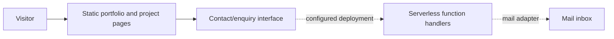

# Personal profile and portfolio — reverse-engineered source map and KT

> **Repository:** [`bv-prasanna/my-profile` `main`](https://github.com/bv-prasanna/my-profile/tree/main), inspected 10 November 2026. Architecture recovered from actual file paths and existing README; **deploy status, email setup and real browser behavior remain unverified.**

## Architecture
**Scope:** Static website and enquiry integration.

No versioned database or server-side identity is visible by repo conventions; do not invent one. Verify that contact functions are deployed and that email delivery works with the configured provider.

## Code inventory
| Dimension | Files matched |
|---|---:|
| JS/TS source and function files | 1 |
| HTML/page entries | 7 |
| Test/spec-related source/doc files | 0 |
| Configuration/deployment source | 1 |

### User-facing pages
- [`index.html`](https://github.com/bv-prasanna/my-profile/blob/main/index.html)
- [`projects/buildpro/index.html`](https://github.com/bv-prasanna/my-profile/blob/main/projects/buildpro/index.html)
- [`projects/jnapanam/index.html`](https://github.com/bv-prasanna/my-profile/blob/main/projects/jnapanam/index.html)
- [`projects/parampara/index.html`](https://github.com/bv-prasanna/my-profile/blob/main/projects/parampara/index.html)
- [`projects/samskruthi/index.html`](https://github.com/bv-prasanna/my-profile/blob/main/projects/samskruthi/index.html)
- [`projects/sevamitra/index.html`](https://github.com/bv-prasanna/my-profile/blob/main/projects/sevamitra/index.html)
- [`projects/wedflow/index.html`](https://github.com/bv-prasanna/my-profile/blob/main/projects/wedflow/index.html)

### Main application code and server-side handlers
- [`functions/api/enquiry.js`](https://github.com/bv-prasanna/my-profile/blob/main/functions/api/enquiry.js)

### Configuration, tests and deployment artifacts
- [`functions/api/enquiry.js`](https://github.com/bv-prasanna/my-profile/blob/main/functions/api/enquiry.js)

## Data storage and migration applicability
**No committed versioned relational schema migration was identified in `main`.** Do not fabricate PostgreSQL tables or migration scripts for this site. The pages are primarily static; functions and project files are linked below for maintenance.
Source HTML and serverless enquiry handlers are the operational record; store the configured recipient addresses and mail service settings in a secure environment register.
[Earlier architecture, deployment, database applicability and KT guide](README.md).

## Source-to-operations validation checklist
1. Enumerate actual public URLs/HTML routes, browser viewport/accessibility and client-side state with smoke tests.
2. Trace contact or job interaction to the exact handler (if used). Verify status codes, validation, network timeout, spam controls and **user-friendly** errors.
3. Ensure no secrets in HTML/client bundles, test safe HTTP headers, CSRF/origin policy, rate limiting and privacy handling.
4. Pin approved commit, create verified production build, deploy staging and test external service deliveries using test data.
5. Document real DNS, Cloudflare/hosting account, env vars **without values**, delivery service setup, logs, alert owner and rollback deployment.
6. Sign off UAT in desktop/mobile browser; negative tests include broken links, invalid forms, unavailable email provider, oversized file uploads if enabled, cross-origin access, storage loss, missing permission and accessibility.

## KT demo
Walk through key screens; describe architecture and trust boundaries; demonstrate test enquiry or local export, expected friendly errors, deployment/build commands, smoke tests, monitoring and recovery. Confirm owners and escalation contacts. **Do not claim live delivery or synchronisation unless a real test confirms it.**